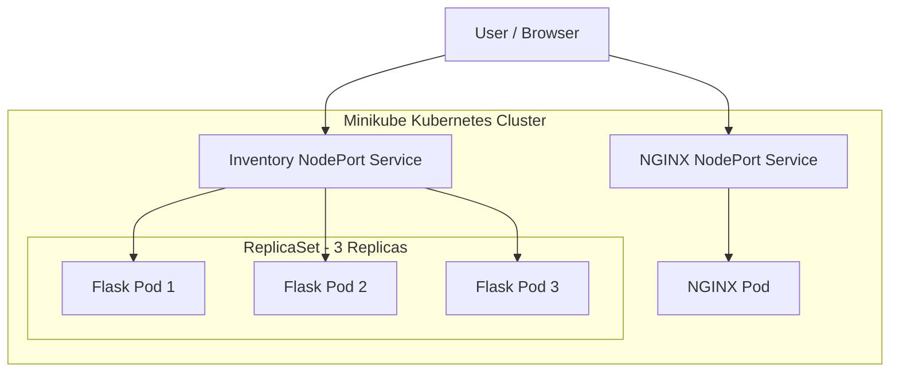

# E-Commerce Inventory Service Deployment using Kubernetes

## 1. Problem Statement

An e-commerce company requires an inventory service deployed on a local Kubernetes cluster. The application must be accessible to users and support multiple replicas to handle incoming traffic. Kubernetes should automatically replace failed or deleted Pods to maintain application availability.

## 2. Objective

- Set up a local Kubernetes cluster using Minikube.
- Deploy an NGINX application and expose it using a NodePort Service.
- Develop a Flask REST API that returns inventory information in JSON format.
- Containerize the Flask application using Docker.
- Deploy the Flask application using Kubernetes YAML manifests.
- Configure three replicas using a ReplicaSet.
- Demonstrate automatic Pod replacement.
- Verify Service-based request routing across available Pods.

## 3. Tools and Technologies

| Tool | Purpose |
|---|---|
| Ubuntu 22.04 (WSL) | Development environment |
| Docker | Containerization |
| Minikube | Local Kubernetes cluster |
| Kubernetes | Container orchestration |
| Flask | REST API development |
| Python | Application programming |
| YAML | Kubernetes configuration |
| NGINX | Web server |
| GitHub | Source code management |

## 4. Architecture



## 5. Implementation

### Step 1: Start Minikube

```bash
minikube start
minikube status
minikube kubectl -- get nodes
```

### Step 2: Deploy NGINX

Created an NGINX Pod and NodePort Service using `nginx.yaml`.

```bash
minikube kubectl -- create namespace inventory-exam
minikube kubectl -- apply -f nginx.yaml
minikube kubectl -- get pods -n inventory-exam
minikube kubectl -- get services -n inventory-exam
minikube service nginx-nodeport -n inventory-exam --url
```

Verified the NGINX welcome page in the browser.

### Step 3: Develop Flask REST API

Created `app.py` with three endpoints:

- `/` – Displays the application welcome message.
- `/inventory` – Returns inventory information in JSON format.
- `/health` – Returns application health status.

Sample inventory includes Laptop, Mobile Phone, and Headphones.

### Step 4: Build Docker Image

```bash
docker build -t inventory-api:v1 .
minikube image load inventory-api:v1
```

### Step 5: Deploy Three Replicas

Created `flask-deployment.yaml` using a Kubernetes ReplicaSet with three replicas.

```bash
minikube kubectl -- apply -f flask-deployment.yaml
minikube kubectl -- get replicasets -n inventory-exam
minikube kubectl -- get pods -n inventory-exam
```

Verified that all three Flask Pods were running.

### Step 6: Create Kubernetes Service

Created `flask-service.yaml` using a NodePort Service.

```bash
minikube kubectl -- apply -f flask-service.yaml
minikube kubectl -- get services -n inventory-exam
minikube service inventory-service -n inventory-exam --url
```

Accessed the `/inventory` endpoint and verified the JSON response.

### Step 7: Demonstrate Automatic Pod Replacement

Deleted one Flask Pod:

```bash
minikube kubectl -- delete pod <pod-name> -n inventory-exam
```

Verified that Kubernetes automatically created a replacement Pod.

```bash
minikube kubectl -- get pods -n inventory-exam
minikube kubectl -- get replicasets -n inventory-exam
```

The ReplicaSet maintained three running replicas.

### Step 8: Verify Service Routing

```bash
minikube kubectl -- get endpoints inventory-service -n inventory-exam
```

Sent multiple requests to the inventory API and observed different Pod names in the responses, demonstrating request distribution across the available replicas.

## 6. Expected Results

- NGINX welcome page accessible through the browser.
- Flask REST API returns inventory information in JSON format.
- Three Flask Pods running successfully.
- ReplicaSet maintains the desired replica count of three.
- Deleted Pod is automatically replaced.
- Kubernetes Service routes requests to available Flask Pods.

## 7. Project Files

| File | Description |
|---|---|
| `app.py` | Flask inventory REST API |
| `requirements.txt` | Python dependencies |
| `Dockerfile` | Docker image configuration |
| `nginx.yaml` | NGINX Pod and NodePort Service |
| `flask-deployment.yaml` | Flask ReplicaSet configuration |
| `flask-service.yaml` | Flask NodePort Service |
| `README.md` | Project documentation |

## 8. Conclusion

Successfully deployed an e-commerce inventory service using Docker, Flask, and Kubernetes on Minikube. Demonstrated NGINX access, REST API functionality, three-replica configuration, automatic Pod replacement, and Service-based request routing.
